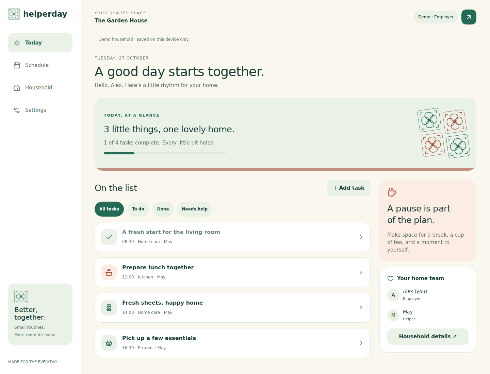

# Helperday

A little rhythm. A happier home.

A mobile-first shared planner for Singapore households and helpers. Built with **Expo SDK 58, Expo Router, React Native, TypeScript and NativeWind**. The same application targets Android, iOS and web. Peranakan and Minimal styles each support light, dark and device appearance.

## Preview



[Peranakan dark on mobile](docs/helperday-mobile-peranakan-dark.png)

## Run the demo

```sh
npm ci
npm run web
```

Choose **Explore the demo**. Create tasks, complete them, leave notes, browse the next five weeks and switch roles in Settings. Demo changes persist on this device, without an account. Demo invitations are deliberately disabled; nothing is sent to another person.

For native development, use `npm run android` / `npm run ios` with a compatible SDK 58 development environment. SDK 58 availability in Expo Go depends on the installed client; use a development build when required. Native bundle export is not a signed APK/IPA or proof of device testing.

## Connect a real household

1. Create a Supabase project.
2. Run `supabase/migrations/202610270001_helperday.sql` once in the project's SQL editor (or apply it with Supabase CLI migrations).
3. Copy `.env.example` to `.env`. Set `EXPO_PUBLIC_SUPABASE_URL` and the project's **publishable/anon key**. Never use a service-role key in the client.
4. Configure Supabase email authentication, email delivery and the confirmation Site URL for your deployed web origin. Restart Expo after setting environment variables.
5. Register and confirm an employer account, sign in, and create a household. Set the agreed rest day.
6. Create a helper invitation on Household. Share the code yourself; the app never sends an invitation automatically.
7. On another device, register/confirm the helper account and choose **Use an invitation**. Enter the code and name. The role comes from the server invitation, not a client-side selector.

Each account belongs to one household in this MVP. Employers may invite helpers or other employers. Invitations expire after seven days and can be used once. Backend provisioning and public hosting are separate from the source code; no paid resources are created by this repository.

## Included

- Today, a five-week schedule, household membership, and appearance settings.
- One-off, daily and weekly tasks; explicit Singapore dates/times and optional rest-day skipping.
- Per-occurrence completion, feedback and requests for help.
- Employers schedule tasks; helpers update their own or unassigned tasks. Authorization is enforced in PostgreSQL RPCs, not just hidden buttons.
- Account-scoped persisted snapshots and an offline outbox for **existing task status/feedback changes**. Persist-before-display; retry every 15 seconds while open, on foreground, or via Sync now.
- Idempotent mutation IDs and optimistic version checks. Conflicts remain visible and retain your note; copy it, discard the pending change, then review and reapply against the latest task.
- Auth tokens use SecureStore on native and browser storage on web. Household snapshots/outbox use local AsyncStorage and are not encrypted; use trusted devices.

## Validation

```sh
npm run typecheck
npm run lint
npm test
npm run build:web
npx playwright install chromium
npm run test:e2e
npm run export:native
```

Tests execute the migration in PGlite's real Postgres engine with authenticated/anonymous roles and an `auth.uid()` stand-in. They cover tenant isolation, write restrictions, single-use invites, repeat generation, rest days, idempotent retries and stale-version conflicts. Browser tests cover creating/completing tasks, persistence, roles, themes and narrow layouts. They do not replace a two-device check against a provisioned Supabase project.

## Deployment

`npm run build:web` produces `dist/`. Use a static host with SPA fallback to `index.html` for routes such as `/settings`. The exported environment values are baked in: rebuild when changing the backend. `npm run preview:web` serves the production export locally.

`eas.json` includes an internal Android APK profile and a production profile. Native store release requires your Expo account, application signing and Apple/Google developer accounts. No store upload or public deployment is performed automatically.

## Deliberate first-version limits

- English UI; domain data is separated for future localization. No automatic translation.
- Polling while open, not push/background notifications or guaranteed background sync.
- Creating tasks, joining households and invitations require a live connection. Only existing task status/feedback updates are queued offline.
- No editing/cancelling recurrence rules, shopping lists, attachments, expenses or payroll yet.
- One shared weekly rest day per household; it is chosen at creation. More flexible per-person rest arrangements need an additional model.
- Demo schedules are a fixed five-week sample. Production schedules are materialized on a rolling basis; existing occurrence records are never overwritten.
- No production cloud, physical-device or store-signing validation is claimed until those environments are connected.

See [architecture](docs/architecture.md) for data and synchronization decisions. MIT licensed.

## Real local Supabase integration tests

Run `npm run test:integration` after `npm ci` and installing Playwright Chromium, with Docker running. The isolated disposable stack exercises real JWT/RLS/RPC authorization, two-account browser sync, offline outbox persistence, conflicts and idempotent retries. See [setup, coverage and validation limits](docs/supabase-integration.md). This is separate from the Demo/PGlite checks and does not claim physical-device validation.
